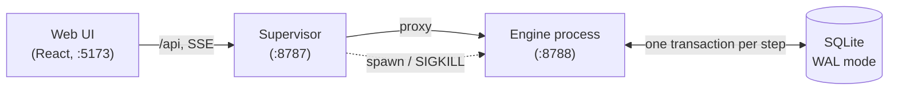

# Workflow Automation Engine

A durable workflow engine built for the Tech Ahir assessment.

> *"When a new order arrives, if it is over $500, wait one day, then send a follow-up message."*

Type a sentence like that, and the engine turns it into a workflow and runs it for every matching event. Many runs execute at the same time. If the engine is killed partway through, every run carries on from where it stopped, and **no message is ever sent twice**.

---

## Contents

1. [At a glance](#at-a-glance)
2. [Quick start](#quick-start)
3. [Demo in 60 seconds](#demo-in-60-seconds)
4. [Design note: 50,000 concurrent workflows](#design-note-50000-concurrent-workflows)
5. [How it works](#how-it-works)
6. [Why no message is sent twice](#why-no-message-is-sent-twice)
7. [Testing](#testing)
8. [Performance](#performance)
9. [Plain-English parser](#plain-english-parser)
10. [API](#api)
11. [Project layout and configuration](#project-layout-and-configuration)
12. [Limitations](#limitations)

---

## At a glance

| The brief asks for | What's here | Proof |
|---|---|---|
| Trigger, conditions, steps (task, wait, branch, message) | All four step types, plus trigger-level conditions | [How it works](#how-it-works) |
| Create workflows from plain English | Rule-based parser (**no AI**) with clear errors | 9 unit tests |
| Many runs at the same time | Leased, concurrent scheduler | 200-run tests, ~540 runs/s measured |
| Survive a stop/restart, no duplicate messages | One transaction per step + unique delivery keys | Engine hard-killed 3× mid-run: 0 duplicates |
| Design note for 50,000 workflows | Six bullets below | [Design note](#design-note-50000-concurrent-workflows) |

**Stack:** Node 22 server with **zero dependencies** (built-in `node:sqlite`, `node:http`, Server-Sent Events) · React + Vite + Tailwind web UI.

---

## Quick start

**Requirements:** Node **22.13+** and pnpm **9+** (`corepack enable` provides pnpm).

```bash
git clone https://github.com/kavyysachaniya/WorkFlowAutomation.git
cd WorkFlowAutomation
pnpm install
pnpm dev            # then open http://localhost:5173
```

| Command | What it does |
|---|---|
| `pnpm dev` | Starts the engine, its supervisor and the web UI |
| `pnpm test` | Parser tests + crash test + multi-engine test (~10s) |
| `pnpm --filter server bench` | Throughput benchmark (optional) |
| `pnpm build` | Production build of the web UI |

The database lives in `server/data/`. Delete that folder to start fresh.

---

## Demo in 60 seconds

| # | Click | What you'll see |
|---|---|---|
| 1 | **Load demo** | The order sentence above is parsed into `if total > 500 → wait 1 day → send follow-up` |
| 2 | **Fire 20 orders** | 20 runs start. 11 orders are over $500 and start waiting; 9 skip the branch and finish |
| 3 | **Kill engine** | The engine process is hard-killed (SIGKILL). Runs freeze where they are |
| 4 | **Start engine** | The engine reclaims the frozen runs and continues each from its saved step |
| 5 | Check **Deliveries** | Exactly **11** follow-ups, no duplicates. Click any run to see its step timeline |

To show the parser directly, click the sentence (or the **High-value order** example), press **Parse**, edit the steps, and **Save**.

> One demo "day" is 3 seconds by default. Change it with the **1 day =** selector.

---

## Design note: 50,000 concurrent workflows

This project runs on one machine with SQLite. To run 50,000 workflows at once, I would keep the same core guarantee (one transaction per step) and change the infrastructure around it:

1. **Partitioned scheduler.** Split runs into partitions by `hash(run_id)`. Each scheduler node owns a set of partitions, so nodes never compete for the same rows and capacity grows by adding nodes.
2. **Durable state in Postgres (or a log + queue).** The "execute step + advance run + record message" transaction works unchanged in Postgres. Workers claim runs with `SELECT … FOR UPDATE SKIP LOCKED`, or runnable work goes on a durable queue (Kafka/SQS) with run state kept in Postgres.
3. **Timer wheel or delayed queue for waits.** Don't poll 50,000 wake-up times. Keep near-term wake-ups in an in-memory timer wheel per partition, and long waits in a delayed queue (SQS delay, Redis sorted set, or a time-bucketed index).
4. **Lease-based claiming with fencing.** Short leases with heartbeats, plus a fencing token checked on every commit. A paused or cut-off worker can never advance a run after losing its lease. This project already does the lease and ownership check.
5. **Idempotency keys end to end.** An `event_id` on every incoming event (already implemented), and `(run_id, step_index)` as the key for every outgoing email, SMS or webhook, so the provider itself rejects duplicates.
6. **Backpressure and per-tenant rate limits.** Cap in-flight work per node, rate-limit each tenant and channel, and return `429` when partitions fall behind, so one busy customer can't slow everyone else down.

---

## How it works



- **Engine:** holds the scheduler, executes steps, and serves the API and live event stream.
- **Supervisor:** a small parent process that starts the engine and can hard-kill it, which powers the demo's Kill/Start buttons.
- **SQLite:** the only place state lives. The engine keeps nothing in memory that a restart can't rebuild.

### Workflows and steps

A workflow is a **trigger** (an event name such as `order.placed`), optional **conditions** on the event data, and a list of **steps**:

| Step | What it does |
|---|---|
| `task` | Runs a unit of work (simulated in this project) |
| `wait` | Pauses the run until a stored wake-up time; survives restarts |
| `branch` | Checks a condition; if false, skips the next *N* steps |
| `message` | Sends an email, SMS or Slack message (recorded in `deliveries`, not actually sent) |

The demo sentence becomes:

```json
{
  "trigger": { "event": "order.placed" },
  "steps": [
    { "type": "branch",  "condition": { "field": "total", "op": "gt", "value": 500 }, "skip": 2 },
    { "type": "wait",    "amount": 1, "unit": "day" },
    { "type": "message", "channel": "email", "body": "Follow-up message" }
  ]
}
```

### Data model

| Table | Purpose | Key constraint |
|---|---|---|
| `workflows` | Workflow definitions | |
| `runs` | One row per run: `status`, `step_index`, `wake_at`, `lease_owner`, `lease_expires` | `UNIQUE(workflow_id, event_id)`, so a repeated event doesn't start a second run |
| `step_log` | One row per executed step | `UNIQUE(run_id, step_index)` |
| `deliveries` | One row per message sent | `UNIQUE(run_id, step_index)` |

### The scheduler

Every 250 ms, the engine:

1. **Claims** due runs (`wake_at <= now`, no live lease) with a single atomic `UPDATE … RETURNING`, stamping each with its lease.
2. **Executes** each claimed run's steps one at a time, each in its own transaction, until the run hits a `wait` or finishes.
3. **Releases** the lease in that final transaction. A waiting run is just a row with a `wake_at` time; nothing sleeps in memory.

On startup, the engine clears expired leases and resumes every unfinished run from its saved `step_index`.

---

## Why no message is sent twice

Each step runs inside **one SQLite transaction**:

```
BEGIN
  check: do I still hold this run's lease, and is it still at this step?
  write step_log (run_id, step_index)
  if message step: write deliveries (run_id, step_index)
  advance the run: step_index + 1, new status, new wake_at
COMMIT
```

What a crash at each point means:

| Engine dies… | Result |
|---|---|
| **before** COMMIT | Everything rolls back. On restart the step runs again, and nothing was recorded the first time |
| **after** COMMIT | The step is done and the run has moved on. It is never repeated |

There's no moment where a message is recorded but the run hasn't advanced, or the other way round. As a second safety net, `deliveries` has `UNIQUE(run_id, step_index)`: a duplicate would fail loudly, not send silently.

**Several engines sharing one database:**
- **Claiming:** a claim is one atomic statement, so two engines can never claim the same run.
- **Committing:** every commit re-checks lease ownership, so an engine that lost its lease can't advance the run.
- **Contention:** a busy database is retried, never treated as a failed run.

---

## Testing

All tests start **real engine processes** on temporary databases. Results below are from Windows 11, Node 22.22.3.

| Test | What it proves | Result |
|---|---|---|
| `parser.test.js` (9 tests) | The parser handles the brief's own sentence, conditions, units, channels and errors; every parsed workflow passes the engine's validator | 9/9 pass |
| `crash.test.js` | 200 runs; the engine is **SIGKILLed 3 times** mid-run and restarted. Every run must finish, with each message delivered exactly once | 200/200 complete, 500/500 deliveries, **0 duplicates** |
| `multi-engine.test.js` | Two engines share one database and split 200 runs. Then one engine is killed and the other must finish its runs | Work split ~50/50, **0 duplicates**, takeover verified |

The full suite passed every time I ran it during development; I never saw a failing run.

<details>
<summary><b>What the crash test checks in detail</b></summary>

- **Workflow:** 8 steps: task, email, wait, task, branch (`plan = pro`), Slack (pro only), wait, SMS.
- **Events:** 200, half `pro` and half `free`, each with an `event_id`. Re-sending one must not create a new run.
- **For every run:**
  - the exact expected messages were delivered (pro: steps 1, 5, 7; free: steps 1, 7), **each exactly once**;
  - the exact expected steps were logged;
  - its lease was released.
- **Totals:** 500 deliveries, and zero duplicate `(run, step)` pairs.

Sample output:

```
kill #1: {"runs":{"pending":138,"waiting":62},"deliveries":63}
kill #2: {"runs":{"pending":18,"waiting":182},"deliveries":183}
kill #3: {"runs":{"pending":9,"waiting":191},"deliveries":263}
final:   {"runs":{"completed":200},"deliveries":500}
verified 200 runs, 500 deliveries (expected 500), 0 duplicates
```

</details>

<details>
<summary><b>Multi-engine test output</b></summary>

```
steps executed per engine: [{"engine":"engine-19420-…","n":744},{"engine":"engine-24140-…","n":756}]
verified 200 runs, 500 deliveries (expected 500), 0 duplicates
takeover verified: 500 deliveries (expected 500), 0 duplicates
```

</details>

<details>
<summary><b>UI click-through (22/22 checks)</b></summary>

I ran a temporary Playwright script against the real app in Edge. It is not part of the repo. Starting from an empty database, it checked:

- **Builder:** empty states, a parse error being shown, then parse → edit a step → add, reorder and delete steps → rename → save, with the edit confirmed in the API.
- **Demo flow:** Load demo → Fire 20 orders → Kill engine (controls disabled while it's down) → Start engine → all runs complete with 11 follow-ups and 0 duplicates.
- **Runs and workflows:** run timelines (including steps skipped by a branch), run filters, firing from a workflow card, changing demo speed, archiving, and Build manually.
- **Phone width (390px):** no horizontal scrolling, header controls visible, timeline opens.
- **Console:** no unexpected errors.

</details>

---

## Performance

`pnpm --filter server bench` runs thousands of 4-step workflows on **one engine process** (laptop, Windows 11), firing events over HTTP while the engine works. Every run verified 0 duplicates.

| Setting | Runs | Time | Throughput | What limits it |
|---|---|---|---|---|
| Default (64 runs at once) | 2,000 | 8.5s | **236 runs/s** | Scheduler cap: 64 claims per 250 ms tick |
| 256 runs at once | 5,000 | 9.3s | **538 runs/s** (~1,900 steps/s) | One process doing all event intake and database writes |
| 1,024 runs at once | 5,000 | 10.6s | 472 runs/s | Same; more concurrency doesn't help |

Every step is a durable transaction, so ~1,900 per second is about the ceiling of one SQLite writer. That's why the [design note](#design-note-50000-concurrent-workflows) moves to partitioned Postgres or a queue. Waiting runs cost almost nothing (one row each), so the number of *concurrent* workflows is limited by storage, not by this rate.

---

## Plain-English parser

The parser is **rule-based (regex), not AI**, and the UI labels it as such. It recognises:

| Kind | Examples |
|---|---|
| Triggers | "when a user signs up", "when a new order arrives", "when a cart is abandoned", or any event name like `order.refunded` |
| Trigger conditions | "only if total is greater than 50 and country is IN" |
| Branches | "if plan is pro", "if it is over $500", "if total is less than 20" |
| Waits | "wait 2 days", "after a week", "delay 30 mins" |
| Messages | "send a welcome email", "text them a code", "send a Slack message to the team", or quoted text |
| Tasks | Sentences starting with verbs like create, tag, assign, update, mark |

**Scope of an `if`:** it covers the rest of its sentence. In *"if it is over $500, wait one day, then send a follow-up"*, both the wait and the message only happen for large orders.

**Errors, not guesses:** anything it can't understand is reported back, naming the exact phrase.

```
"When the moon rises, send email"
→ Unknown trigger. Known: signs up, places an order, abandons cart, …
```

The parser sits behind a small interface (`server/src/parsers.js`), so an LLM-based parser could be added later. Its output would still go through the same validation.

---

## API

The supervisor serves everything on port 8787. The web UI reaches it through Vite's proxy.

| Method | Path | Purpose |
|---|---|---|
| `POST` | `/api/parse` | `{text}` → workflow JSON, or `422` with `{errors: [{clause, reason}]}` |
| `GET` / `POST` | `/api/workflows` | List or create workflows (validated) |
| `DELETE` | `/api/workflows/:id` | Archive a workflow |
| `POST` | `/api/events` | Fire a trigger: `{event, payload, event_id?}`. `event_id` prevents duplicate runs |
| `GET` | `/api/runs`, `/api/runs/:id` | Runs; the detail view includes step log and deliveries |
| `GET` | `/api/deliveries`, `/api/stats` | Delivered messages; counts |
| `GET` / `PUT` | `/api/config` | Demo speed: `{day_ms}` |
| `GET` | `/api/stream` | Live events (SSE): `run.created`, `step`, `delivery`, `run.completed`, … |
| `POST` | `/sup/kill`, `/sup/start` | Demo controls (`kill` is a real SIGKILL) |

---

## Project layout and configuration

```
server/                 Node 22, zero dependencies
  src/engine.js         scheduler, leases, step execution (the core)
  src/db.js             SQLite schema
  src/parser.js         rule-based plain-English parser
  src/parsers.js        parser interface
  src/server.js         engine process: HTTP API + SSE
  src/supervisor.js     starts/kills the engine, proxies the API
  test/                 parser, crash and multi-engine tests; benchmark
web/                    React + Vite + Tailwind + lucide-react UI
scripts/dev.mjs         one-command dev launcher
```

| Environment variable | Default | Meaning |
|---|---|---|
| `DAY_MS` | `3000` | Real milliseconds per simulated "day" |
| `LEASE_MS` | `3000` | How long a claim is valid before another engine may take over |
| `MAX_CONCURRENCY` | `64` | Runs one engine works on at once |
| `AUTO_RESTART` | off | Set to `1` and the supervisor restarts a killed engine by itself |

---

## Limitations

- **Simulated tasks and messages.** Nothing is actually sent; "exactly once" is guaranteed up to the `deliveries` table. A real sender would pass `(run_id, step_index)` to the provider as an idempotency key (see design note #5).
- **A task's work can repeat after a crash.** Its simulated work runs before its transaction, so if the engine dies mid-task the work runs again on resume, though its recorded result appears only once. Real tasks with side effects would also need idempotency keys.
- **Single machine.** Several engine processes on one machine are tested, but SQLite allows only one writer at a time, so this doesn't scale out. That's what the design note addresses.
- **Process crashes vs power loss.** The database setting used survives process crashes (what's tested). A power cut could lose the last few transactions, but they roll back cleanly, so it still can't create duplicates.
- **Parser vocabulary.** The vocabulary is fixed, and there are no "else" branches or loops.
- **Small runtime behaviours:**
  - after a restart, runs resume within one lease period (3s);
  - changing demo speed affects only new waits;
  - live updates aren't stored, so the UI reconnects and also polls every 4s.
- **Untested:** stopping `pnpm dev` with Ctrl+C is meant to kill all its processes, but I couldn't test a real Ctrl+C automatically.
- **Not covered:** no authentication or multi-tenancy. `node:sqlite` is still marked experimental in Node 22.
